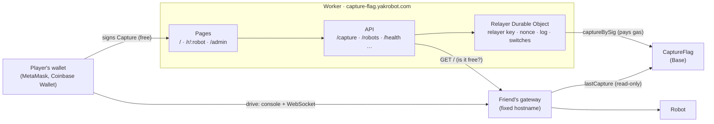
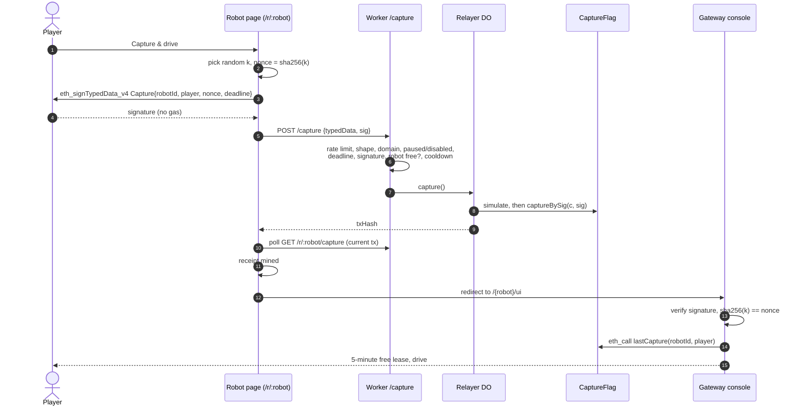

# Architecture

Capture the flag lets anyone drive a yakrobot robot for 5 minutes for free. A player
signs one message in their wallet (a "capture"), the game records it on Base and pays the
gas, and the robot's own gateway lets that player drive.

Three parts, run by different people:

| Part | Where | Run by | Holds |
|---|---|---|---|
| `CaptureFlag` contract | Base Sepolia `0xF3F2e69A1b00577d5d6ca1911a3a80132CD08737` (`contracts/`) | the owner wallet | the record of every capture |
| The Worker | `capture-flag.yakrobot.com` (`worker/`, Cloudflare Workers) | the game owner | the relayer key (gas only), the pages, the switches |
| A gateway per robot | the friend's fixed hostname (`yakrobot-gateway`, capture-flag mode) | each friend | the robot; **no keys** |

## A ride, end to end

The capture is public once relayed (the signature is in the calldata), so it can't be
the ride ticket on its own. The **ride secret `k`** is: the page signs
`nonce = sha256(k)` and hands `k` only to the player's own browser, in the URL fragment.
The gateway needs `sha256(k) == nonce`, so someone watching the chain can't take the
ride. Each capture rides once (the gateway remembers which have started).

## The contract

`CaptureFlag` records captures and moves no tokens.

- `captureBySig(c, sig)`, **only from the relayer**: checks the deadline, the player's
  unused nonce, the cooldown (10 min per robot per player) and the EIP-712 signature,
  then updates the counters and emits `Captured`.
- Public reads: `lastCapture`, `captureCount`, `totalCaptures`, `uniqueCapturers`,
  `playerTotal`, `mostCaptures`/`topCapturer` (ties go to whoever got there first).
- Owner only: `setRelayer` (and `setRelayer(0x0)` is the **hard stop**), `setCooldown`.
  Ownership can't be renounced.
- `robotId = keccak256(host + "/" + robot)`: the gateway's fixed hostname plus its robot
  name. A new hostname is a new robot, with counters from zero.

`contracts/test/vectors.json` pins the EIP-712 hashing that the contract, the Worker and
the gateway each implement. Change it only together with all three.

## The Worker

One Cloudflare Worker (Hono + viem) with one Durable Object.

**Pages** (single HTML files, inlined, no build step):
- `/`: every robot with its state (free, busy until HH:MM, offline, disabled) and the
  network leaderboard.
- `/r/:robot`: one robot. Status, previous drivers and the most-rides leader, the
  Capture button, and a saved Drive button for 30 minutes.
- `/admin`: the owner's switches.

**API:**

| Route | What |
|---|---|
| `POST /capture` | Every gas-free check, in order, then the relayer. 409 if the robot is busy or offline (no gas spent). |
| `GET /robots`, `GET /r/:robot/status` | The switches first, then each gateway's `GET /` (3 s timeout). |
| `GET /r/:robot/drivers`, `GET /leaderboard` | From the relayer's log, plus the on-chain leader and a `names` map. |
| `GET /r/:robot/capture?player&nonce` | A capture's current transaction (it may have been re-sent), or 404 if it failed. |
| `GET/POST /admin/state` | The switches; POST takes an owner-signed message. |
| `GET /health` | Relayer balance, `relayer() == ours`, unmined sends. 503 when not ok. |

**The Relayer Durable Object** is a single instance named `relayer`, and the only place
the relayer key is read. It:
- sends `captureBySig` one at a time, keeping the relayer's nonce itself;
- logs every send (SQLite: `captures`, `counts`, `totals`), complete because the
  contract only accepts the relayer;
- keeps unmined sends in `pending`. An alarm re-sends one stuck for 10 blocks with fees
  +25% (up to 3 times), or, if it would now revert, sends a no-op to free the nonce and
  marks the capture `reverted`;
- holds the switches: `paused` (the whole game, **on** after a fresh deploy) and
  `disabled:<robot>`;
- caches player names: a Base primary name (`alice.base.eth`), else a mainnet ENS name,
  both looked up through the ENS Universal Resolver on Ethereum mainnet (ENSIP-19), which
  checks the name points back to the address. Re-checked daily; looked up after the
  response, so pages never wait for them.

**Configuration** (`wrangler.jsonc`): `CHAIN`, `CONTRACT`, `ROBOTS` (slug →
`{gateway, robot, label, place}`), `RELAYER_MIN_WEI`, `DRIVERS_SHOWN`, `SENDS_PER_HOUR`.
Secrets: `RELAYER_PRIVATE_KEY`, `RPC_URL`, and optionally `ENS_RPC_URL` (an Ethereum
mainnet RPC; player names are off without it). Triggers: a cron every 15 minutes that logs
when `/health` fails.

## The gateway

A friend runs `yakrobot-gateway` with `TELEOP_CAPTURE_FLAG_ENABLED=1`. It's the free
reservation mode with one extra check on `/{robot}/lease/reserve`:

1. a valid EIP-712 signature over the capture, for this gateway's own `robotId`
   (from `NGROK_DOMAIN`/`CLOUDFLARE_DOMAIN`, never the `Host` header);
2. `sha256(k) == nonce`;
3. one read-only `eth_call` of `lastCapture`, recent enough (30 min) and not ridden yet.

The gateway holds no key and sends no transaction. If the RPC is down, it refuses new
rides (503); rides already going continue. Safety stays on the robot (deadman timer, one
driver at a time).

## Who can stop what

| Control | Who | How | Effect |
|---|---|---|---|
| Pause / Resume | owner wallet | `/admin`, `personal_sign`, no gas | No new captures anywhere |
| Disable / Enable a robot | owner wallet | `/admin` | No new captures of that robot |
| Hard stop | owner wallet | `setRelayer(0x0)` on the contract, costs gas | Every `captureBySig` reverts, whatever the Worker does |
| Take a robot offline | its friend | stop the gateway | Shows offline; captures 409 |

Rides already started always run to the end of their lease: the gateway owns rides.

## Limits and abuse

- **Per IP:** 10 requests a minute on `POST /capture` and `/admin/state` (IPv6 per /64).
- **Per game:** at most `SENDS_PER_HOUR` (60) relayed captures an hour, counting failed
  ones, so many fresh wallets can't drain the relayer.
- **Per player:** the contract's 10-minute cooldown per robot, and one ride per capture.
- **The relayer** holds only gas money. If its key leaks, the owner calls
  `setRelayer(<new>)`.
- Players need only an ordinary wallet account (EOA): no ETH, no gas. Smart-contract
  wallets can't sign captures yet.

## Further reading

- Owner's runbook: [README](../README.md#owners-runbook).
- Friend's runbook: `yakrobot-gateway` README, "Running a robot in the capture-flag game".
